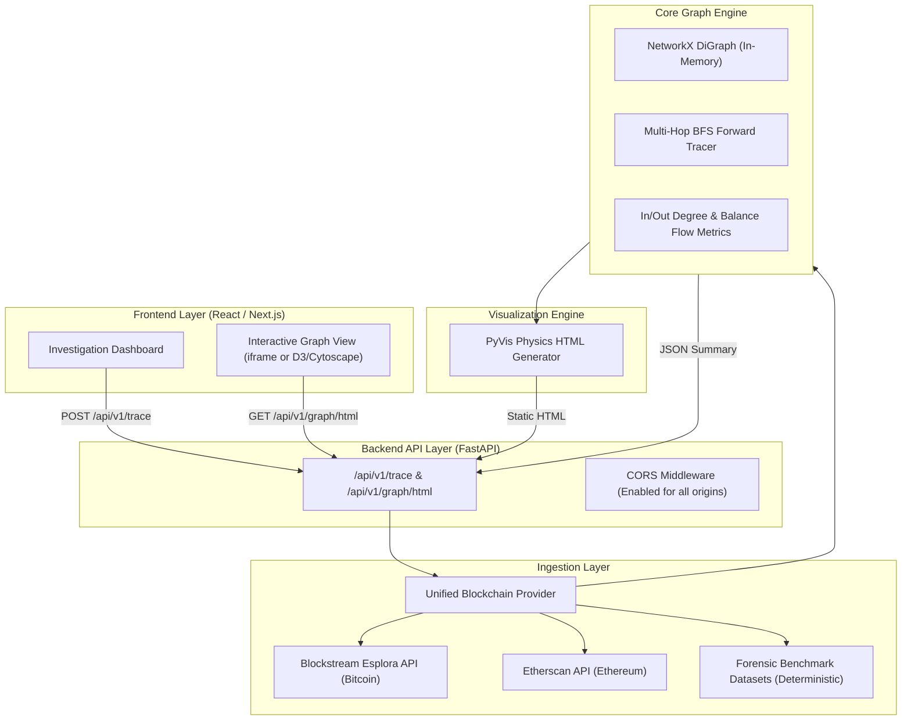

# CryptoTrace — System Architecture & Integration Guide

## 1. System Overview
**CryptoTrace** is a security-oriented forensic intelligence system built to investigate suspicious cryptocurrency transaction networks and detect adversarial attempts to manipulate the trace.

This document describes the backend architecture, data flow, and API contracts for seamless integration with frontend applications (e.g., React, Next.js, or Vue dashboards).

---

## 2. Architectural Layers



---

## 3. Intelligent Traversal & Forensic Stopping Conditions

Rather than blindly expanding every transaction path, the graph traversal engine (`core/graph.py`) prioritizes high-value flow (peel-chain trunks) and enforces **4 forensic stopping conditions**:

1. **Terminal Cash-Out (Exchange) or Mixer Pool:**
   - Identified via `core/entities.py` (Binance, Coinbase, Kraken, Tornado Cash).
   - Once funds enter a custodial exchange or tumbler, on-chain public tracking ceases. The branch terminates, flagging the exchange/mixer as an **End Receiver**.
2. **Cold Storage Sink (Dormant Accumulation):**
   - When a recipient wallet has `out_degree == 0` (unspent funds), tracing stops and attributes the wallet as a cold storage sink.
3. **Max Hop Depth Boundary:**
   - Tracing stops when the configurable depth limit (`max_hops`, default 3) is reached, preventing infinite recursion.
4. **Sub-Threshold Pruning (Dilution Guard):**
   - Transferred amounts below `min_amount_threshold` are pruned from traversal, preventing spam/dust noise from expanding.

---

## 4. Directory Layout (Rooted at `/cryptotrace`)

```
cryptotrace/
├── server/                # Complete Python Backend Engine
│   ├── main.py            # Unified FastAPI app factory & uvicorn entrypoint
│   ├── routes.py          # API route handlers (/trace, /benchmarks, /graph/html)
│   ├── requirements.txt   # Backend Python packages
│   ├── core/              # Graph engine and data definitions
│   │   ├── models.py      # Pydantic models (Transaction, AddressNode, TraceResponse)
│   │   ├── entities.py    # Entity identification (Exchanges, Mixers, Sanctions)
│   │   └── graph.py       # NetworkX DiGraph builder & multi-hop BFS tracer
│   ├── ingestion/         # Multi-source blockchain data ingestion
│   │   ├── base.py        # Abstract Base Provider
│   │   ├── live_api.py    # Blockstream & Etherscan API client with fallback
│   │   └── benchmark.py   # Ground-truth forensic scenarios (peel-chain, dusting)
│   ├── viz/               # Interactive visualization module
│   │   └── renderer.py    # PyVis HTML generator with custom node physics
│   ├── static/            # Generated visualization files (served via FastAPI)
│   └── tests/             # Comprehensive test suite
│       └── test_pipeline.py
│
├── client/                # Frontend application directory (React / Next.js)
│   └── README.md          # Frontend integration notes
│
└── docs/                  # Architectural and integration documentation
    └── architecture.md
```

---

## 4. API Reference for Frontend Developers

### Base URL: `http://localhost:8000`

### 4.1 Health Check
* **Endpoint:** `GET /api/v1/health`
* **Response:**
```json
{
  "status": "ok",
  "service": "CryptoTrace Forensic Backend",
  "version": "1.0.0"
}
```

---

### 4.2 List Pre-Packaged Forensic Benchmarks
* **Endpoint:** `GET /api/v1/benchmarks`
* **Response:** Returns known test scenarios (e.g., Bitcoin 3-hop peel chain with Binance cashout, Ethereum tumbler mixer). Use these for demo buttons in the UI.

---

### 4.3 Initiate Forensic Trace
* **Endpoint:** `POST /api/v1/trace`
* **Headers:** `Content-Type: application/json`
* **Request Body:**
```json
{
  "target_address": "bc1q_hacker_ransomware_vault",
  "max_hops": 3,
  "currency": "BTC",
  "min_amount_threshold": 0.0,
  "generate_viz": true
}
```

* **Response Body (`200 OK`):**
```json
{
  "target_address": "bc1q_hacker_ransomware_vault",
  "currency": "BTC",
  "max_hops": 3,
  "total_nodes": 7,
  "total_edges": 8,
  "nodes": [
    {
      "address": "bc1q_hacker_ransomware_vault",
      "in_degree": 0,
      "out_degree": 4,
      "total_received": 0.0,
      "total_sent": 49.90008,
      "balance_estimate": -49.90008,
      "tags": [],
      "is_source": true,
      "hop_distance": 0
    },
    {
      "address": "bc1q_binance_deposit_exchange",
      "in_degree": 1,
      "out_degree": 0,
      "total_received": 40.0,
      "total_sent": 0.0,
      "balance_estimate": 40.0,
      "tags": [],
      "is_source": false,
      "hop_distance": 3
    }
  ],
  "transactions": [...],
  "end_receivers": [
    {
      "address": "bc1q_binance_deposit_exchange",
      "hop_depth": 3,
      "amount_reached": 40.0,
      "path": [
        "bc1q_hacker_ransomware_vault",
        "bc1q_change_hop1",
        "bc1q_change_hop2",
        "bc1q_binance_deposit_exchange"
      ],
      "stopping_reason": "Terminal Cash-out Point Detected: Binance Deposit Address",
      "entity_type": "EXCHANGE",
      "entity_name": "Binance Deposit Address",
      "is_terminal_cashout": true,
      "is_mixer": false,
      "tags": ["EXCHANGE:Binance Deposit Address"],
      "is_sink": true
    },
    {
      "address": "bc1q_change_hop3",
      "hop_depth": 3,
      "amount_reached": 4.499,
      "path": [
        "bc1q_hacker_ransomware_vault",
        "bc1q_change_hop1",
        "bc1q_change_hop2",
        "bc1q_change_hop3"
      ],
      "stopping_reason": "Cold Storage Sink: funds unspent (out-degree: 0)",
      "entity_type": null,
      "entity_name": null,
      "is_terminal_cashout": false,
      "is_mixer": false,
      "tags": [],
      "is_sink": true
    }
  ],
  "viz_html_available": true,
  "viz_html_path": "/api/v1/graph/html?address=bc1q_hacker_ransomware_vault",
  "execution_time_ms": 14.5
}
```

---

### 4.4 View Interactive Trail Graph
* **Endpoint:** `GET /api/v1/graph/html?address={address}`
* **Usage in Frontend:** Embed directly inside an `<iframe>` in your React/Next.js dashboard:
```jsx
<iframe 
  src="http://localhost:8000/api/v1/graph/html?address=bc1q_hacker_ransomware_vault"
  width="100%" 
  height="700px" 
  style={{ border: "none", borderRadius: "12px" }}
/>
```

---

## 5. Security & Ingestion Robustness
1. **Adversarial Labeling:** Ingested edges flag known adversarial anomalies (`is_adversarial: true`, `adversarial_tag: "DUSTING_ATTACK"`).
2. **Dual-Mode Ingestion:** If live APIs encounter rate-limiting or network issues, the system smoothly falls back to forensic benchmark fixtures, guaranteeing zero demo downtime.
3. **CORS:** Middleware is enabled for all origins, so local frontend dev servers (`localhost:3000`, `localhost:5173`) can communicate directly without reverse proxies.
