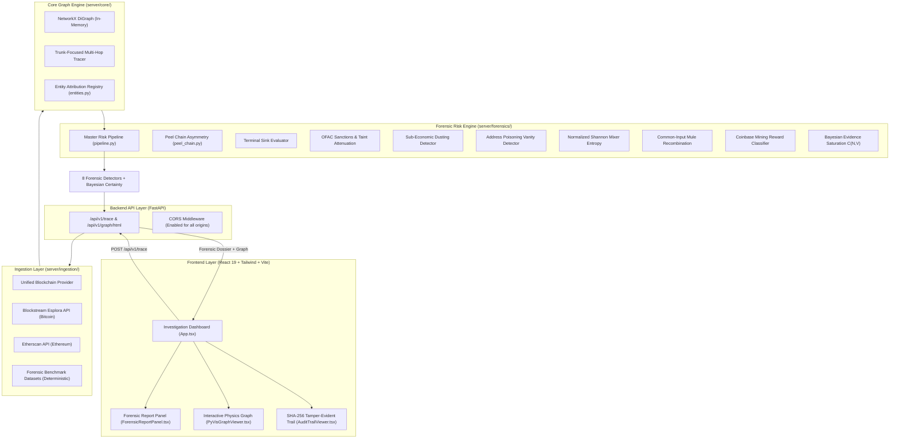

# CryptoTrace — System Architecture & Integration Guide

## 1. System Overview
**CryptoTrace** is a security-oriented forensic intelligence system built to investigate suspicious cryptocurrency transaction networks and detect adversarial attempts to manipulate the trace.

This document describes the backend architecture, data flow, forensic risk pipeline, and API contracts for seamless integration with frontend applications (e.g., React, Next.js, or Vite dashboards).

---

## 2. Architectural Layers



---

## 3. Intelligent Traversal & Forensic Stopping Conditions

Rather than blindly expanding every transaction path (causing exponential $O(b^d)$ graph explosion), the engine enforces **Trunk-Focused Traversal** and **Forensic Boundary Conditions**:

1. **Peel Chain Trunk Focus (Zero-Explosion):**
   - When a transaction matches the generalized asymmetry metric ($\Delta_{\text{peel}} \ge 0.85$), the crawler *only* expands down the primary trunk wallet.
   - Small peeled amounts (fees/expenses) are captured as evidence but not recursively expanded, allowing deep multi-hop traces (up to 15 hops) without API rate limits or lagging.
2. **Terminal Cash-Out (Exchange) or Mixer Pool:**
   - Identified via `core/entities.py` (Binance, Coinbase, Kraken, Tornado Cash).
   - Once funds enter a custodial exchange or tumbler pool, on-chain tracking ceases. The branch terminates, flagging the destination as an **End Receiver**.
3. **Cold Storage Sink (Dormant Accumulation):**
   - When a recipient wallet has `out_degree == 0` (unspent funds), tracing stops and attributes the wallet as a cold storage sink.
4. **Max Hop Depth Boundary:**
   - Configurable depth limit (`max_hops`, default 5, up to 15).
5. **Verified Non-Profit / Charity Exemption:**
   - Recognized non-profit organizations (e.g., Internet Archive, Wikimedia) are attributed as `BENIGN`, protecting public infrastructure from false-positive criminal alerts.

---

## 4. Directory Layout (Rooted at `/cryptotrace`)

```
cryptotrace/
├── server/                    # Python FastAPI Forensic Backend
│   ├── main.py                # FastAPI app factory & uvicorn entrypoint
│   ├── routes.py              # API routes (/trace, /benchmarks, /graph/html)
│   ├── requirements.txt       # Backend dependencies
│   ├── core/                  # Graph engine & data models
│   │   ├── models.py          # Pydantic schemas (Transaction, AddressNode, TraceResponse)
│   │   ├── entities.py        # Entity registry (Exchanges, Mixers, OFAC, Benign)
│   │   ├── graph.py           # NetworkX DiGraph builder & multi-hop tracer
│   │   └── logger.py          # Unified structured logging
│   ├── forensics/             # Modular Forensic Detection Engine
│   │   ├── peel_chain.py      # Generalized change-address asymmetry algorithm
│   │   └── pipeline.py        # Master orchestrator (8 detectors + Bayesian certainty)
│   ├── ingestion/             # Multi-source blockchain data ingestion
│   │   ├── base.py            # Abstract Base Provider
│   │   ├── live_api.py        # Blockstream Esplora & Etherscan API client
│   │   └── benchmark.py       # Ground-truth forensic test fixtures
│   ├── viz/                   # Interactive visualization module
│   │   └── renderer.py        # PyVis HTML physics graph compiler
│   ├── static/                # Rendered graph HTML & assets
│   └── tests/                 # Full unit and integration test suite
│       ├── test_forensics.py  # Forensic detector unit tests
│       └── test_pipeline.py   # API & graph integration tests
│
├── client/                    # Frontend Application (React 19 + Vite + Tailwind)
│   ├── src/
│   │   ├── App.tsx            # Main investigation dashboard
│   │   ├── components/
│   │   │   ├── ForensicReportPanel.tsx # Threat score & 8-module evidence dossier
│   │   │   ├── ChainFlowPipeline.tsx   # Interactive SVG hop-by-hop pipeline
│   │   │   ├── PyVisGraphViewer.tsx    # Interactive physics network graph
│   │   │   └── AuditTrailViewer.tsx    # SHA-256 cryptographic proof viewer
│   │   ├── services/api.ts    # Backend HTTP client
│   │   └── types/index.ts     # TypeScript interfaces (TraceResponse, ForensicReport)
│   └── package.json
│
└── docs/                      # Architectural & Mathematical Documentation
    ├── forensic_problems_and_solutions.md # Problem tracker & live implementation matrix
    ├── mathematical_specifications.md     # Formulas (Sigmoid, Shannon Entropy, Bayes)
    └── architecture.md                    # System architecture guide
```

---

## 5. API Reference

### Base URL: `http://localhost:8000`

### 5.1 Initiate Forensic Trace
* **Endpoint:** `POST /api/v1/trace`
* **Headers:** `Content-Type: application/json`
* **Request Body:**
```json
{
  "target_address": "bc1q_hacker_ransomware_vault",
  "max_hops": 5,
  "currency": "BTC",
  "min_amount_threshold": 0.0,
  "generate_viz": true
}
```

* **Response Body (`200 OK`):**
```json
{
  "target_address": "bc1q_hacker_ransomware_vault",
  "currency": "BTC",
  "max_hops": 5,
  "total_nodes": 9,
  "total_edges": 8,
  "forensic_report": {
    "target_address": "bc1q_hacker_ransomware_vault",
    "hops_analyzed": 5,
    "overall_risk": {
      "score": 100.0,
      "level": "CRITICAL",
      "confidence_score": 98.2,
      "confidence_level": "HIGH",
      "summary": "2 consecutive peel hops detected; Funds terminate at Binance Deposit Address; Target address is directly registered on OFAC sanction list."
    },
    "function_risks": {
      "peel_chain": {
        "risk_score": 30.0,
        "status": "FLAGGED",
        "reason": "2 consecutive peel hops detected along trunk bc1q_chang...; 5.40 BTC peeled off while bulk remained on trunk."
      },
      "terminal_sink": {
        "risk_score": 25.0,
        "status": "FLAGGED",
        "reason": "Funds terminate at centralized exchange cash-out deposit point: Binance Deposit Address."
      },
      "sanctions": {
        "risk_score": 100.0,
        "status": "FLAGGED",
        "reason": "Target address is directly registered on OFAC/sanction list: Ransomware Vault (Primary Actor)."
      },
      "dusting_attack": {
        "risk_score": 0.0,
        "status": "CLEAN",
        "reason": "No unsolicited micro-dust or tracking probe transactions detected in inflows."
      },
      "address_poisoning": {
        "risk_score": 35.0,
        "status": "FLAGGED",
        "reason": "Address poisoning spoofing attack detected: Decoy transfer spoofing look-alike vanity address."
      },
      "mixer_entropy": {
        "risk_score": 0.0,
        "status": "CLEAN",
        "reason": "Output distributions show normal economic variance; no equal-denomination mixing entropy detected."
      },
      "cluster_recombination": {
        "risk_score": 0.0,
        "status": "CLEAN",
        "reason": "No multi-input common ownership clustering or co-spend recombination detected."
      },
      "mining_origin": {
        "risk_score": 0.0,
        "status": "CLEAN",
        "reason": "No newly minted Coinbase block rewards detected in inflows."
      }
    }
  },
  "nodes": [...],
  "transactions": [...],
  "end_receivers": [...],
  "viz_html_available": true,
  "viz_html_path": "/api/v1/graph/html?address=bc1q_hacker_ransomware_vault",
  "audit_trail": {
    "target_address": "bc1q_hacker_ransomware_vault",
    "total_steps": 4,
    "is_valid_chain": true,
    "latest_audit_hash": "...",
    "steps": [...]
  },
  "execution_time_ms": 14.2
}
```

---

### 5.2 Health & Status
* **Endpoint:** `GET /api/v1/health`
* **Response:**
```json
{
  "status": "ok",
  "service": "CryptoTrace Forensic Backend",
  "version": "1.0.0"
}
```
