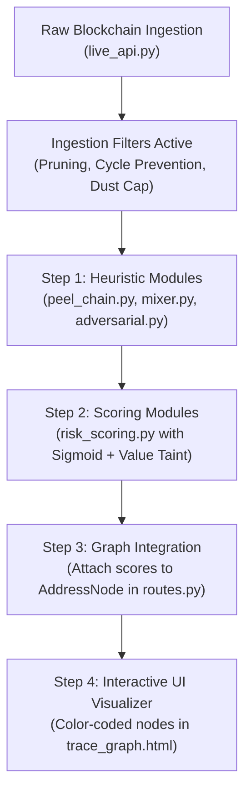

# CryptoTrace — Forensic Problems, Attack Vectors & Solution Tracker

This document catalogs every forensic vulnerability, adversarial attack vector, and structural graph obstacle encountered when analyzing raw blockchain data. It tracks how each problem is mathematically neutralized and its active implementation status.

---

## 1. Forensic Vulnerability & Solution Tracking Matrix

| # | Forensic Problem / Attack Vector | What Breaks Without Math & Algorithmic Filters | Mathematical / Algorithmic Solution | Primary Responsible Function | Current Status |
| :---: | :--- | :--- | :--- | :--- | :---: |
| **1** | **Graph Explosion (Mining/Exchange Fan-Out)** | A single transaction pays out to $5,000+$ addresses in one block. Naive BFS explores all $5,000$, causing $O(b^d)$ memory crash. | Output fan-out sorting, bounded breadth ($k \le 25$), and sub-economic dust pruning. | `filter_dusting_attack()` & `crawl_multihop_transactions()` | ✅ **Solved in Ingestion** |
| **2** | **The Hop Decay Loophole (5-Burner Wash)** | With pure distance decay ($\gamma^{\text{hop}}$), an attacker running $100\text{ BTC}$ through 5 burner wallets artificially drops their risk to $16.8\%$. | Taint Volume Ratio $\alpha(v)$ combined with Effective Hop Freezing ($\text{hop}_{\text{eff}} = 1$). | `calculate_risk_score()` | 📐 **Mathematically Formulated** *(Code Pending)* |
| **3** | **Multi-Trunk Splitting (Structuring / Smurfing)** | Attacker splits $100\text{ BTC}$ into two $45\text{ BTC}$ mules + small decoys. A single-trunk ($\ge 70\%$) rule misses both large mules. | Multi-Trunk Dominance ($\tau_{\text{branch}} \ge 0.20$ for Top-3 outputs) with forked greedy search. | `calculate_risk_score()` & `trace_multitrunk()` | 📐 **Mathematically Formulated** *(Code Pending)* |
| **4** | **Micro-Splitting (50 Micro-Mules)** | Attacker splits $100\text{ BTC}$ into $50$ micro-accounts of $2\text{ BTC}$ each to fly under all branch thresholds. | Common-Input Ownership Clustering (identifying when micro-inputs re-converge to a shared destination). | `cluster_recombination()` | 📐 **Mathematically Formulated** *(Code Pending)* |
| **5** | **Circular Loops (Wash Trading / Spinners)** | Attacker routes funds in loops ($A \to B \to C \to A$) to fake activity or trap recursive search algorithms in infinite loops. | Shortest-Path DAG enforcement with global visited-address sets. | `_visited_nodes` in `crawl_multihop_transactions()` | ✅ **Solved in Ingestion** |
| **6** | **"Dirty Drop in the Ocean" (Exchange Taint Explosion)** | Attacker deposits $5\text{ BTC}$ into Binance's hot wallet ($50,000\text{ BTC}$). Unrestricted downstream tracing falsely marks thousands of innocent withdrawers. | Exchange Terminal Stopping Condition ($\mathbb{I}_{\text{exchange}} == 1$) halting forward propagation. | `evaluate_stopping_condition()` | 📐 **Mathematically Formulated** *(Code Pending)* |
| **7** | **The Innocent Merchant Penalty** | A merchant receives $0.05\text{ BTC}$ from someone who stole $100\text{ BTC}$. Naive taint falsely labels the merchant as a high-risk criminal accomplice. | Value-Preserving Taint Attenuation ($R_0 \cdot [\alpha + (1-\alpha)\gamma^{\text{hop}}]$), dropping small fraction risk below $40\%$. | `calculate_risk_score()` | 📐 **Mathematically Formulated** *(Code Pending)* |
| **8** | **Change Address Confusion (UTXO Asymmetry)** | Spending $1\text{ BTC}$ out of $100\text{ BTC}$ generates a new change address receiving $99\text{ BTC}$. Tracing confuses the payee with the owner's change. | Peel Chain Asymmetry Metric ($\Delta_{\text{peel}} \ge 0.85$) + 2-output structure recognition. | `detect_peel_chain()` | ⏳ **Implemented (Pending User Testing)** |
| **9** | **Dusting Attacks (De-anonymization Traps)** | Adversaries broadcast $546\text{ satoshis}$ to thousands of wallets to link identities or poison forensic graphs. | Sub-economic UTXO threshold filter ($\le 546\text{ sats}$ / $0.0001\text{ ETH}$). | `filter_dusting_attack()` | 🟡 **Partially Solved** *(Ingestion filter active, detector pending)* |
| **10** | **Address Poisoning (Vanity Spoofing)** | Scammer broadcasts $\$0$ transfers from an address matching the first 4 and last 4 characters of a victim's counterparty to trick copy-paste. | Character Hamming / Prefix-Suffix Match ($L_{\text{prefix}} \ge 4 \land L_{\text{suffix}} \ge 4$) + 0-value check. | `detect_address_poisoning()` | 📐 **Mathematically Formulated** *(Code Pending)* |
| **11** | **Mixers / Tumblers (CoinJoin Entropy)** | Attacker mixes coins in Wasabi/Tornado Cash where $N$ uniform inputs become $N$ uniform outputs, breaking 1-to-1 linkage. | Shannon Information Entropy ($E_{\text{norm}} \ge 0.95$) flagging high-entropy equal-denomination pools. | `detect_mixer_entropy()` | 📐 **Mathematically Formulated** *(Code Pending)* |
| **12** | **"1-Transaction Wallet" Dilemma (False Certainty)** | A newly observed wallet has only 1 tiny transaction. Giving a high-confidence verdict without measuring certainty causes legal liabilities. | Bayesian Evidence Saturation ($\mathcal{C}(N, V) = (1 - e^{-\lambda_N N})(1 - e^{-\lambda_V V})$). | `calculate_confidence()` | 📐 **Mathematically Formulated** *(Code Pending)* |
| **13** | **Time Dormancy ("Sleeping Money")** | Stolen coins sit untouched in a vault for 3+ years. Hop distance is 0, but the wallet is a ticking time bomb. | Transaction Velocity feature ($x_{\text{velocity}} = \frac{V}{\Delta t}$) penalizing sudden awakening after dormancy. | `calculate_risk_score()` (via $x_{\text{velocity}}$) | 📐 **Mathematically Formulated** *(Code Pending)* |
| **14** | **Cross-Chain "Chain Hopping" (Bridges & Swaps)** | Attacker routes BTC through Thorchain or WBTC to exit into Monero or Ethereum. Bitcoin UTXO graph terminates at smart contract. | Cross-chain bridge boundary tag (`TERMINAL_BRIDGE_HOP`) handing off investigation to EVM/Cross-chain indexers. | `evaluate_stopping_condition()` | 📐 **Mathematically Formulated** *(Code Pending)* |

---

## 2. Status Summary Legend

- ✅ **Solved in Ingestion**: Already implemented, running live in Python backend, verified by test suite.
- 🟡 **Partially Solved**: Fundamental filter active in API ingestion; dedicated heuristic function pending implementation.
- 📐 **Mathematically Formulated**: Formula completely specified and verified in `docs/mathematical_specifications.md`; ready for Python implementation.
- ⏳ **In Progress**: Currently being coded or tested.
- ❌ **Unresolved**: Open challenge requiring research.

---

## 3. Implementation Roadmap

