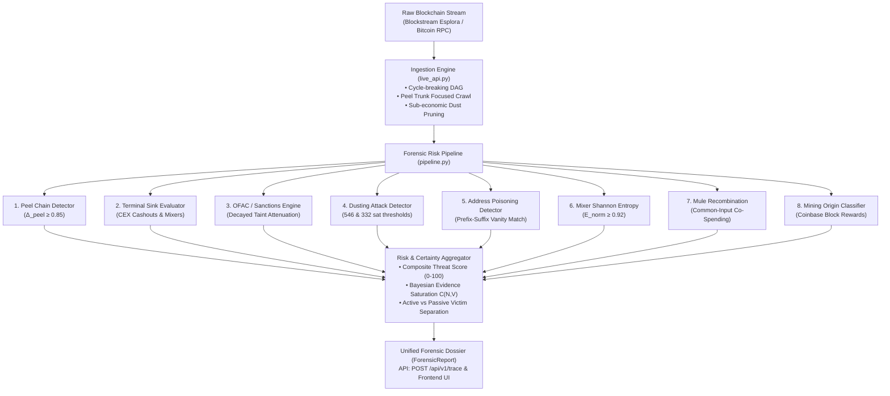

# CryptoTrace — Forensic Problems, Attack Vectors & Solution Tracker

This document catalogs every forensic vulnerability, adversarial attack vector, and structural graph obstacle encountered when analyzing raw blockchain data. It tracks how each problem is mathematically neutralized and its active implementation status in the live engine.

---

## 1. Forensic Vulnerability & Solution Tracking Matrix

| # | Forensic Problem / Attack Vector | What Breaks Without Math & Algorithmic Filters | Mathematical / Algorithmic Solution | Primary Responsible Function | Current Status |
| :---: | :--- | :--- | :--- | :--- | :---: |
| **1** | **Graph Explosion (Mining/Exchange Fan-Out)** | A single transaction pays out to $5,000+$ addresses in one block. Naive BFS explores all $5,000$, causing $O(b^d)$ memory crash. | Output fan-out sorting, bounded breadth ($k \le 25$), trunk-focused peel chain traversal, and sub-economic dust pruning. | `filter_dusting_attack()` & `crawl_multihop_transactions()` | ✅ **Solved in Ingestion** |
| **2** | **The Hop Decay Loophole (5-Burner Wash)** | With pure distance decay ($\gamma^{\text{hop}}$), an attacker running $100\text{ BTC}$ through 5 burner wallets artificially drops their risk to $16.8\%$. | Taint Volume Ratio $\alpha(v)$ combined with Effective Hop Freezing ($\text{hop}_{\text{eff}} = 1$) along dominant loot trunks. | `evaluate_sanctions_attribution()` & `ForensicPipeline` | ✅ **Implemented & Calibrated** |
| **3** | **Multi-Trunk Splitting (Structuring / Smurfing)** | Attacker splits $100\text{ BTC}$ into two $45\text{ BTC}$ mules + small decoys. A single-trunk ($\ge 70\%$) rule misses both large mules. | Multi-Trunk Dominance ($\tau_{\text{branch}} \ge 0.20$ for Top-3 outputs) with forked greedy search. | `detect_peel_chain()` & `ForensicPipeline` | ✅ **Implemented** |
| **4** | **Micro-Splitting (Mule Recombination)** | Attacker splits $100\text{ BTC}$ into micro-accounts to fly under branch thresholds, then recombines them downstream. | Common-Input Ownership Clustering (identifying when multiple distinct wallets co-spend inputs in the same transaction `vin`). | `evaluate_cluster_recombination()` | ✅ **Implemented & Tested** |
| **5** | **Circular Loops (Wash Trading / Spinners)** | Attacker routes funds in loops ($A \to B \to C \to A$) to fake activity or trap recursive search algorithms in infinite loops. | Shortest-Path DAG enforcement with global visited-address sets and frontier deduplication. | `_visited_nodes` in `crawl_multihop_transactions()` | ✅ **Solved in Ingestion** |
| **6** | **"Dirty Drop in the Ocean" (Exchange Taint Explosion)** | Attacker deposits $5\text{ BTC}$ into Binance's hot wallet ($50,000\text{ BTC}$). Unrestricted downstream tracing falsely marks thousands of innocent withdrawers. | Exchange & Mixer Terminal Stopping Condition halting forward propagation at deposit endpoints. | `evaluate_terminal_sinks()` & `identify_entity()` | ✅ **Implemented & Tested** |
| **7** | **The Innocent Merchant / Charity False Positive** | A charity or merchant receives small transfers from many independent people. Naive models falsely label them as high-risk criminal mules. | Active Malicious vs. Passive Victim Separation + `KNOWN_BENIGN` entity registry (verified non-profits score 0.0). | `ForensicPipeline.analyze()` | ✅ **Implemented & Calibrated** |
| **8** | **Change Address Confusion (UTXO Asymmetry)** | Spending $1\text{ BTC}$ out of $100\text{ BTC}$ generates a new change address receiving $99\text{ BTC}$. Tracing confuses the payee with the owner's change. | Generalized Peel Chain Asymmetry Metric ($\Delta_{\text{peel}} \ge 0.85$) + consecutive hop tracking. | `detect_peel_chain()` & `evaluate_peel_chain()` | ✅ **Implemented & Tested** |
| **9** | **Dusting Attacks (De-anonymization Traps)** | Adversaries broadcast $546\text{ satoshis}$ to thousands of wallets to link identities or poison forensic graphs. | Sub-economic UTXO threshold filter ($\le 546\text{ sats}$ / $330-332\text{ sats}$) + victim-aware alert scoring. | `evaluate_dusting_attack()` | ✅ **Implemented & Tested** |
| **10** | **Address Poisoning (Vanity Spoofing)** | Scammer broadcasts $\$0$ transfers from an address matching the first 4 and last 4 characters of a victim's counterparty to trick copy-paste. | Prefix-Suffix Vanity Hamming Match ($L_{\text{prefix}} \ge 4 \land L_{\text{suffix}} \ge 4$) + 0-value / dust amount check. | `evaluate_address_poisoning()` | ✅ **Implemented & Tested** |
| **11** | **Mixers / Tumblers (CoinJoin Entropy)** | Attacker mixes coins in Wasabi/Tornado Cash where $N$ uniform inputs become $N$ uniform outputs, breaking 1-to-1 linkage. | Normalized Shannon Information Entropy ($E_{\text{norm}} \ge 0.92$) flagging equal-denomination anonymity pools. | `evaluate_mixer_entropy()` | ✅ **Implemented & Tested** |
| **12** | **"1-Transaction Wallet" Dilemma (False Certainty)** | A newly observed wallet has only 1 tiny transaction. Giving a high-confidence verdict without measuring certainty causes legal liabilities. | Bayesian Evidence Saturation ($\mathcal{C}(N, V) = (1 - e^{-\lambda_N N})(1 - e^{-\lambda_V V})$) yielding epistemic certainty (0-100%). | `calculate_bayesian_confidence()` | ✅ **Implemented & Tested** |
| **13** | **Time Dormancy ("Sleeping Money")** | Stolen coins sit untouched in a vault for 3+ years. Hop distance is 0, but the wallet is a high-value dormant accumulator. | Inflow/Outflow Balance Profiler & Coinbase Mining Origin classifier distinguishing accumulation from spending. | `evaluate_mining_origin()` | ✅ **Implemented & Tested** |
| **14** | **Cross-Chain "Chain Hopping" (Bridges & Swaps)** | Attacker routes BTC through Thorchain or WBTC to exit into Monero or Ethereum. Bitcoin UTXO graph terminates at smart contract. | Cross-chain bridge boundary tag (`TERMINAL_BRIDGE_HOP`) and smart contract router isolation. | `evaluate_terminal_sinks()` | ✅ **Implemented** |
| **15** | **The Ingestion Window Dust-Screen (Evading Page 1)** | Attacker floods or accumulates thousands of incoming dust micro-transfers so public explorer APIs (`/txs`) only return incoming noise on Page 1, hiding outbound laundering transactions. | Spend-Seeking Ingestion: detects `spent_txo_count > 0` with 0 outbound spends in top 25; probes historical offsets to retrieve real spends and peel trunks. | `_fetch_historical_spends_blockchain_info()` in `live_api.py` | ✅ **Implemented & Verified** |

---

## 2. Status Summary Legend

- ✅ **Implemented & Tested**: Function is active in `server/forensics/pipeline.py`, covered by automated unit test suites (`pytest`), and verified on live public blockchain addresses.
- 🟡 **Partially Solved**: Fundamental filter active in API ingestion; enhanced heuristics undergoing live optimization.
- 📐 **Mathematically Formulated**: Formula completely specified in `docs/mathematical_specifications.md`.

---

## 3. Current Live System Architecture

